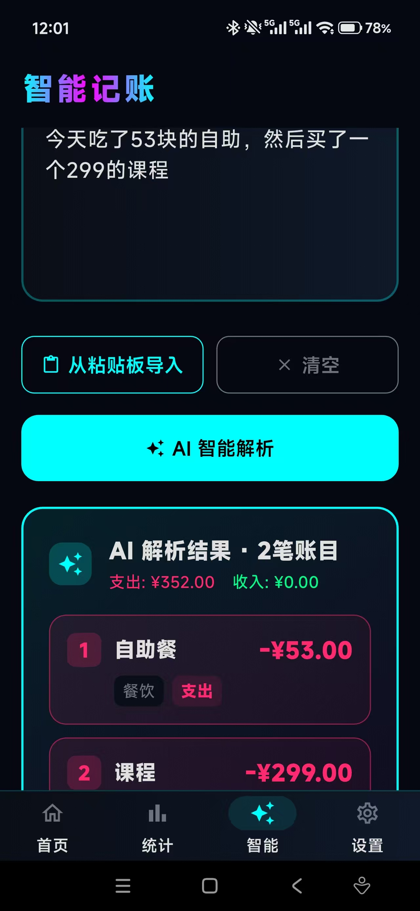
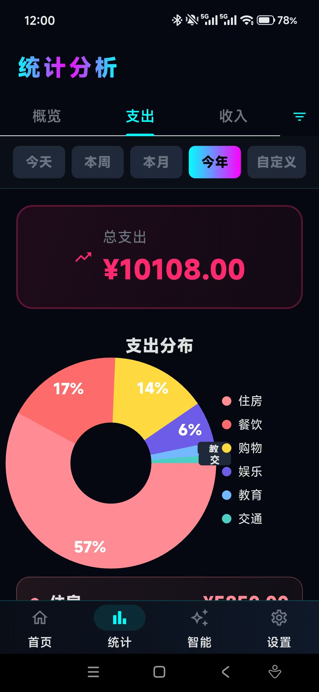
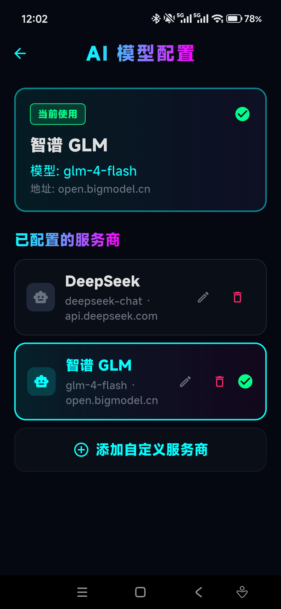

## 为什么做：一个"记账太麻烦"的真问题

记账是件反人性的事：一笔一笔手动录入，坚持不过三天。我试过市面上的记账软件，没有一个支持"说一段话、自动拆成多笔账"——而这恰恰是大模型最擅长的事。

于是我给自己定了一个极简的产品主张：**把记账成本压到接近零。**

- **说一句话就记完**——"早餐七块八，打车二十，昨天买了门课二百四"，AI 自动拆成三笔账，金额、分类、日期全部识别到位
- **语音就是最好的入口**——我平时重度使用输入法的语音转文字，语音 → 文字 → AI 拆账，整条链路没有一个多余步骤
- **隐私优先**——账目数据全部存在本地 SQLite，无需注册登录；AI 只接收你主动提交的那一句话
- **AI 能力开放而非绑定**——不强制用某一家的模型，用户自带 API Key，智谱 GLM、DeepSeek 或任意 OpenAI 兼容接口均可

| 智能记账 | 统计分析 | AI 模型配置 |
| :---: | :---: | :---: |
|  |  |  |

## 怎么做的：一个下午，零 App 开发经验

这个项目有两层"从零到一"：

**产品层面**，Flutter / Dart 跨平台开发我此前完全没有接触过；**开发方式**上，我选择用 Claude Code 搭载 GLM 模型全程 vibe coding——不是辅助补全，而是像和工程师结对一样，把需求聊清楚，让 AI 写代码，我来验收、试用、提修改。

核心的技术工作：

- **LLM 结构化输出**：把自然语言段落解析成带金额 / 分类 / 备注 / 日期的多笔账目 JSON，这是整个产品的核心链路
- **中文语义细节**：中文数字换算（"七块八"→7.8）、相对日期回推（"昨天买的"→自动归到昨天）、智能分类
- **统计与数据资产**：月 / 年收支概览、分类饼图、趋势折线图；账目支持 JSON / CSV 导入导出，随时备份或丢进 Excel 分析

## 收获与成果

**成果**：一个下午从想法到可安装的 App，APK 已发布 [Releases](https://github.com/JiqingJiang/Keep_Accounts/releases)，我自己日常在用，项目完整开源。

**这次实验验证了两件事**：

1. **AI 时代的个人开发是成立的**——零移动端经验的人，靠"清晰的产品判断 + Coding Agent"，也能在几小时内交付一个跨平台、可日常使用的完整产品。 bottleneck 不再是写代码的速度，而是定义问题的能力。
2. **LLM 结构化输出的工程化经验**——让模型稳定输出可解析、字段完整的 JSON，prompt 约束、字段校验与兜底逻辑缺一不可，这个经验直接复用到了我后来的 Agent 项目里。

## 附：Vibe Coding 的边界——项目变大之后

这个 App 功能简单、体量小，一个下午的聊天式开发当然顺畅。但我在后续更大的项目（如 Personal Teachers）里很快发现：**一旦功能复杂、项目体量变大，"用嘴说"的 coding 就开始失灵**。踩过的坑记录在这里：

**1. 会话之间没有记忆。** 切换窗口、新开会话之后，AI 对这个项目一无所知，下一次修改又要把相关文件重新读一遍、把上下文重新讲一遍。项目越大，"让 AI 重新理解项目"的开销越大，有时候光喂上下文就比改代码本身还费劲。

**2. 生成没有约束，结果很随机。** 没有测试、没有规范、没有架构约束时，同一个需求 AI 这次这么写、下次那么写，风格漂移、重复造轮子、悄悄破坏已有功能都是常事。小项目靠人肉验收还能兜住，体量一大，"改好了 A、弄坏了 B"就成了常态——没有自动化测试兜底，你根本不知道它坏了什么。

**3. AI 的能力我发挥不完全。** 真机调试、性能问题、平台差异（Flutter 在 Android / iOS 上的坑）这些"机器看不到、只有现场才知道"的信息，AI 拿不到，就只能靠我人肉描述、来回试错。我会不会提问、能不能把现象描述准确，直接决定了产出质量——很多时候瓶颈在我这边，不在模型。

**4. 需求在聊天中越说越糊。** 口头描述需求看似快，但模糊之处 AI 会自行脑补，做出来才发现不是想要的。返工的沟通成本，比一开始想清楚再动手更高。

**5. 架构会悄悄腐化。** AI 每次只看局部，倾向于"哪里能塞哪里"，没有人在全局守护分层和一致性。项目一做大，代码很快变成"AI 风格"的大泥球，之后每一次修改都更难。

**我的结论**：vibe coding 适合探索期——想法验证、原型、个人小工具，它的速度优势是碾压性的；但进入工程期，需要的反而是传统软件工程那套东西：写下来的设计文档、给 AI 的项目上下文（而不是靠会话记忆）、自动化测试做护栏、Code Review 式的人工验收。AI 降低的是"写代码"的成本，抬高的是"定义问题、守护质量"的价值。
