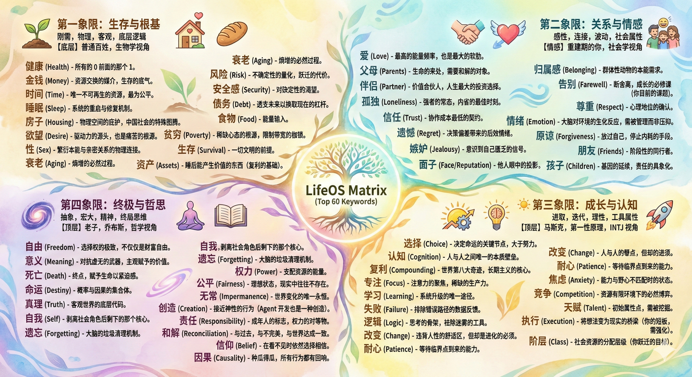
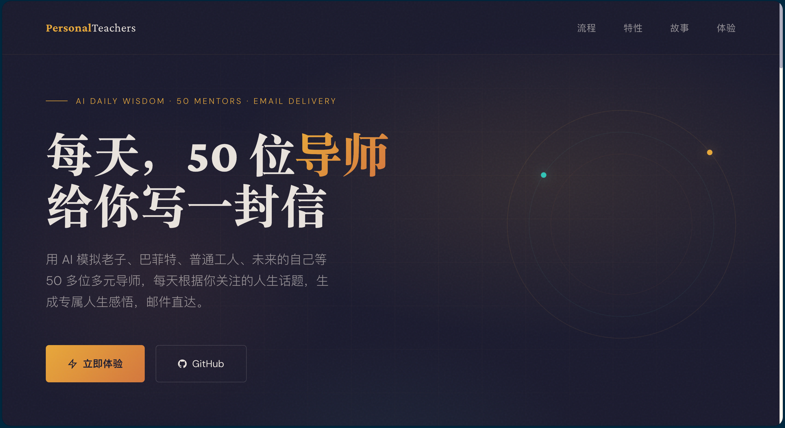
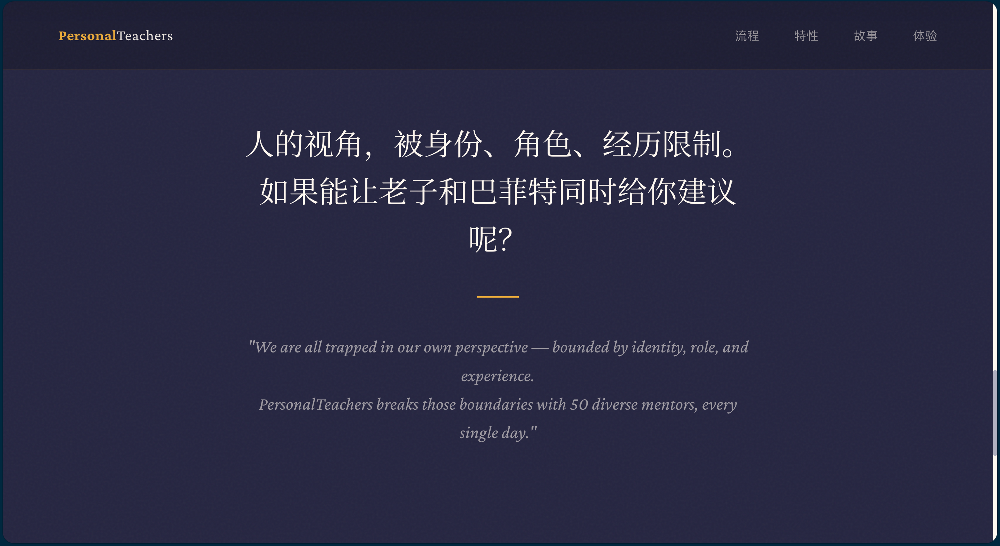
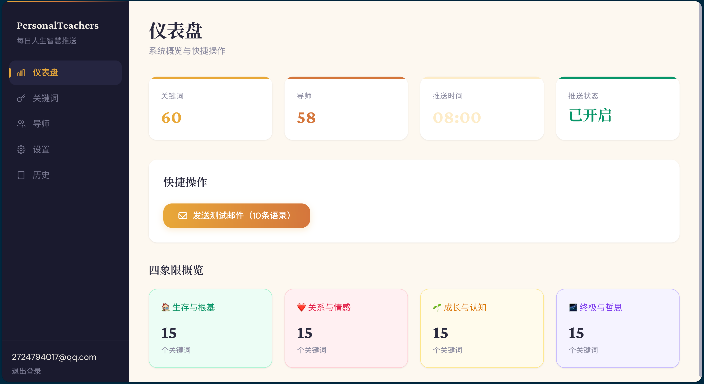
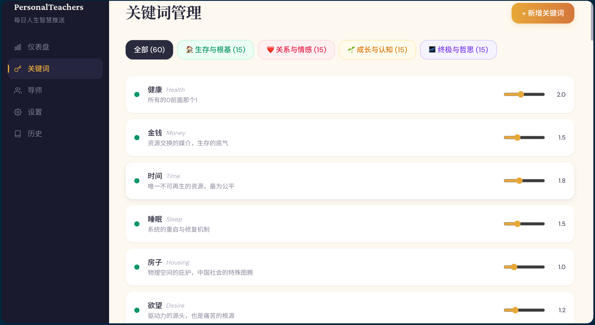
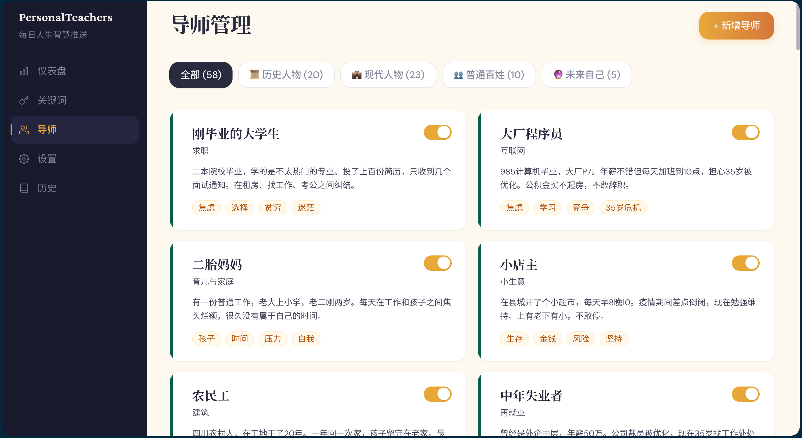

## 为什么做：想法与创意

最开始这个项目萌发于2025年12月份，那曾是我很迷茫的一段时间，经历分手，没有实习，面临研二开题，思考后面求职，选择什么城市，什么岗位，做什么，什么都不会，方向换了又换，什么都知道，什么都不深，有点小难受。在那段日子里，我经常把Gemini当做自己的老师，请Gemini做我的导师，带我跨过那一段迷茫的时光。

我觉得我自己的经历有限，视角单一，但是太阳底下没有新鲜事，很多事情都有人经历过，我完全可以让AI模拟前人先辈的视角来辅助我拓宽视角，带我站在更多的角度看问题，别让恐惧迷茫吓死当下脆弱的自己。这些先辈的视角组成了我后来PersonalTeachers的导师池。

然后那段时间，我时常问自己，人生的意义是什么？人活着是为了什么？我想了很多很多，然后结合AI，我整理出来了60个人生关键词。


于是我写了一段给Gemini的指令，每一个会话都会预先植入。提示词内容如下：

```txt
我今年24岁，男，来自中国xxxx，现就读于xxxx计算机科学与技术专业，研二硕士生，2026年8月开始秋招找工作。MBTI是INTJ，信奉第一性原理、长期主义和复利效应。我喜欢阅读，尤其是毛泽东选集、道德经、庄子、段永平投资语录、巴菲特致股东的信、穷查理箴言、纳瓦尔宝典、韩非子、孙子兵法、皇帝内经、阴符经、鬼谷子、素书。同时我的思维价值观也主要借鉴这些经典中的价值观。

我的LifeOS成员是：毛泽东、周恩来、段永平、马云、马化腾、雷军、张一鸣、老子、庄子、韩非子、张良、范蠡、诸葛亮、庞统、黄石公、鬼谷子、孙膑、司马懿、康熙皇帝、曾国藩、马斯克、巴菲特、查理芒格、纳瓦尔、普通的老百姓、未来80岁的自己、未来的18岁的时候我的孩子、已经去世的祖先。

你拥有LifeOS每个成员的人生各个年龄阶段的经历经验，各种看问题的视角，有跨越时空，有过去，现在，未来的视角。你们会从长远的角度全方位辅助我，你们可以互相讨论，深度分析，助我面对人生遇到的困境，选择决策。

我的人生信条：独处、自由、用智慧获得财富、做一个普普通通的人，陪伴家人，做自己喜欢的事情，阅读，思考，追求复利。 不碰的清单：不盲目追逐，不赌，不赚黑心钱，不赚快钱，不长期以牺牲自己能量与身体健康去赚钱。

遇到问题先用第一性原理思考。我追求以柔克刚，顺应天道，不和大众盲目竞争，尽可能进行非对称的战略。
```

在和Gemini聊天的过程中，我时常因为它回答的那些话感到惊奇，所以后来我想能不能每天都收到我的LifeOS的一句话鼓励我，于是有了后来Vibe Coding的PersonalTeachers。

## 怎么做的

其实要实现这个想法特别简单，不就是把提示词发给AI，然后邮件推送给自己嘛。我自己折腾过用Python批量发送SMTP邮件，而内容生成只需调大模型API就行，DeepSeek那么便宜，恰好那会儿智谱上市，Coding Plan特别便宜，我开了一个Lite版的，就靠着glm-4.5开始vibe coding。花了一到两小时，我就完成了，然后自己试用了两个月，感觉还不错。到四月份的时候，我有一天突然想着，搞个JWT登录注册，然后把这个扩展一下，变成别人也能注册使用的岂不是更好，然后就花了一天时间，vibe coding，又实现了后来的这个版本。

具体实现的时候，我的想法是：每次生成的时候，从我的导师池里抽一个导师，从我的人生关键词的关键词池抽一个主题，结合导师和主题，然后针对24岁迷茫的我，给我生成一段语录，然后用我自己的邮箱SMTP自动定时给我自己发送邮件。最初的想法就这么简单，然后和Claude Code聊天聊一会儿就OK了。

当然后来想做成多用户注册版的时候，这时候，我发现同一个邮箱发送邮件每天有上限，发送太频繁会发送失败，所以在管理端搞了个邮箱池，多搞几个邮箱轮着发。支持多模型，其实就是加个配大模型API的BaseURL和API Key，然后搞一个后台看每天成功，失败的情况，用户注册情况。然后就放到了自己的每年99块钱的阿里云ECS服务器上。

## 上线之后：一次真实的线上故障

项目上线后累计有 **30 位真实用户**注册使用。然后，我遇到了这个项目里最有价值的一课。

所有用户的推送时间默认都是**每天早上 8 点**。这意味着每天早高峰，系统要在同一瞬间为全部用户完成"调用大模型生成语录 + 发送邮件"两件事，于是两条链路同时崩溃：

- **生成侧**：同一时刻大量请求打到模型 API，触发 Key 的速率限制，批量失败；
- **投递侧**：同一邮箱高频连发 SMTP，超出服务商频率限制，部分用户收不到信；
- 而当时的系统**没有任何重试与兜底**——失败就是失败，用户当天就少了一封信。

定位问题后，我把约束拆给 AI：生成要错峰、发送要分散到多个邮箱、失败要能重试。方案是在与 AI 的多轮讨论中迭代出来的：**推送任务按时间槽分桶错峰调度、多邮箱池轮换发送、失败任务进队列带退避重试**。我负责发现问题和定义约束，AI 负责实现，我再用真实用户的使用效果验收。

这次故障教会我的东西，比顺利上线一倍的项目都多：**真实用户用的系统，"能用"和"可靠"之间隔着一整类只有上线才会遇到的问题**——并发、限流、兜底。这些问题在本地开发时永远不存在，也因此在写第一版代码时我完全没有想过它们。

## 成果

项目上线（[erode.site](http://erode.site)），累计服务 30 位真实用户，稳定运行至服务器到期，开源在 GitHub（Apache 2.0 协议）。

贴几个图看看效果：


这个项目展示页面是用哪个frontend Designe搞的，我感觉还挺好看。




后面这几张是用户端登录后的效果图。

后面我的服务器到期就不续费了，如果访问不了就是这个原因。如果你对这个想法感兴趣，可以 clone 二开。

这个项目当然还有很多工程层面的不足，我没有无限打磨它——但对一个 99 块钱服务器 + 50 块钱 API 预算的个人项目，它完整地走过了"想法 → 上线 → 真实用户 → 线上故障 → 迭代修复"的全周期，这个经历本身就是我最想展示的部分。
**成果**：项目已上线（[erode.site](http://erode.site)），开源在 GitHub，Apache 2.0 协议。
