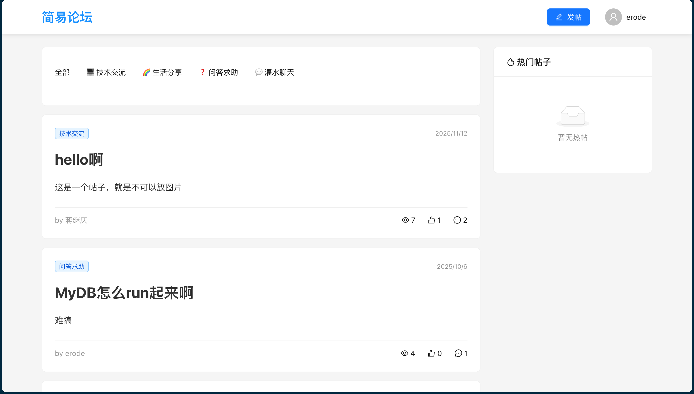
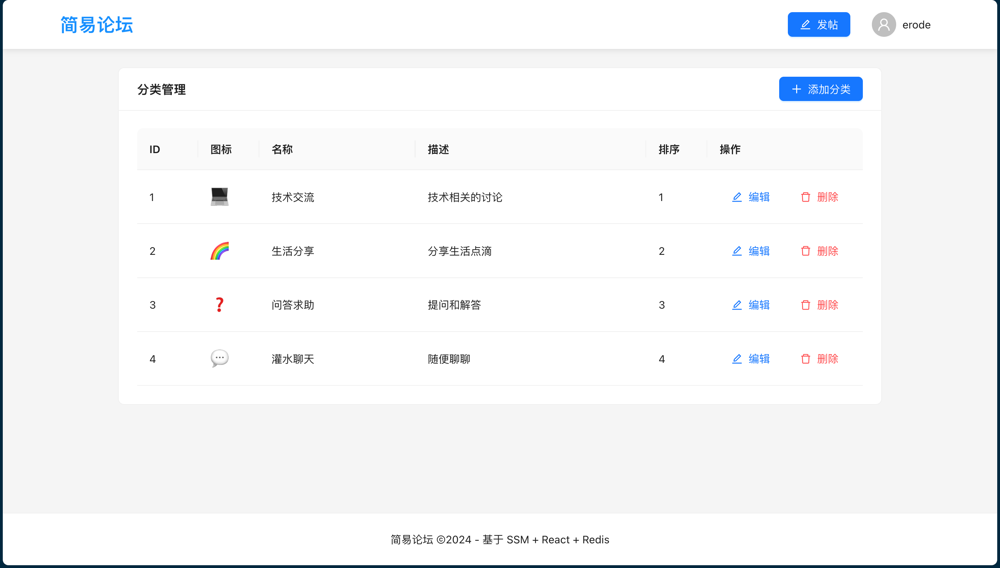
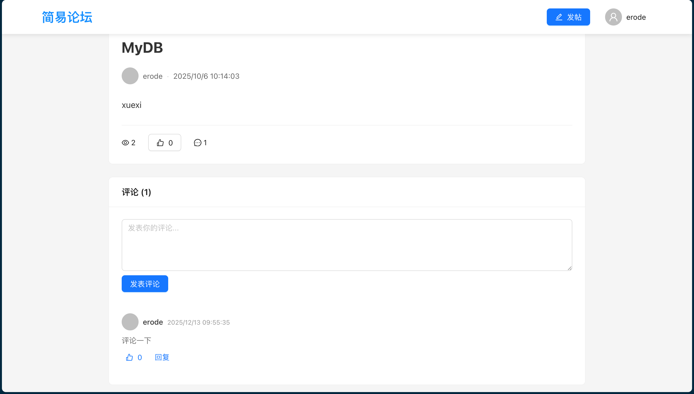

## 为什么做

2025 年 11 月，我在系统学 Java 后端，不想停在"跟着教程敲 Demo"的阶段——真正的业务开发里，比 CRUD 更常见的问题是：怎么认证用户、怎么做缓存、怎么防止重复点赞、热点数据怎么扛。这些恰恰不是一个待办清单小项目能覆盖的。

于是我选了"论坛"这个载体，做了一个类知乎的社区：它天然要求登录注册、内容发布、社交互动（关注、点赞、评论）和数据聚合（排行榜），一周时间，把一个业务开发者的"高频问题清单"完整过了一遍。

| 论坛首页 | 分类管理 |
| :---: | :---: |
|  |  |
|  | |

## 怎么做的

**后端**：SpringBoot 2.7 + MyBatis Plus 3.5 + MySQL 8.0 + Druid + Redis + JWT，标准的 Controller / Service / Mapper 三层结构，RESTful API 设计。

**前端**：React 18 + React Router 6 + Ant Design 5 + Axios，前后端分离，Axios 拦截器统一处理 token 与请求。

**功能清单**：

- 登录 / 注册（JWT 无状态认证）
- 文章发布、浏览、删除，帖子分类管理与分页
- 关注好友
- 点赞（Redis Set 去重）
- 二级评论
- 热帖排行榜与浏览量统计

**三个值得讲的技术点**：

1. **点赞去重**——用 Redis Set 记录"用户-帖子"的点赞关系，SISMEMBER O(1) 判断是否已点赞，天然防重复
2. **热帖排行榜**——热点数据放 Redis 缓存，首页排行榜不用每次实时查库，减轻 MySQL 压力
3. **无状态认证**——JWT 让服务端不存会话，接口天然水平扩展友好

## 收获与成果

**成果**：一周完成前后端全部功能，项目完整开源，功能全部可用。

**这次练手补齐了我 Java 后端的基本功**：

- 完整掌握了 SpringBoot 后端的标准分层套路：从建表、实体、Mapper 到 Service、Controller 的全链路
- 第一次把 Redis 用进真实业务，理解了缓存、去重这些"业务开发高频问题"的标准解法
- 走通了前后端分离的完整协作：接口设计、跨域处理、token 鉴权、前后端联调

回头看，这个小项目是我从"会写 Java"到"能做系统"的转折点——后来做 Personal Teachers 时的登录注册、JWT、后台管理，用的都是这里练熟的那一套。
